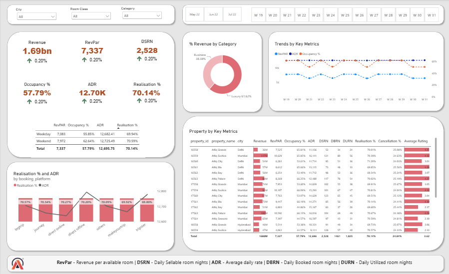

# 🏨 Hospitality Revenue Insights Dashboard | Power BI

## 📌 Project Overview

**Hospitality Revenue Insights** is an interactive Power BI dashboard developed to analyze hotel performance and uncover revenue trends across multiple properties in India.

The dashboard provides insights into **25 hotel properties across 4 cities**, operating under AtliQ Grands, a luxury/business hotel chain. It enables users to monitor key hospitality metrics, compare regional performance, evaluate room occupancy, and identify opportunities to improve revenue generation.

The project focuses on transforming raw booking data into meaningful business insights that can support data-driven decision-making for revenue managers, regional managers, and business strategists.

## 🛠️ Tech Stack

The dashboard was developed using the following tools and technologies:

- **Power BI Desktop:** Primary platform used for data visualization and dashboard development.
- **Power Query:** Used for data cleaning, transformation, and preparation.
- **DAX (Data Analysis Expressions):** Used to create calculated measures, KPIs, and dynamic business metrics.
- **Data Modeling:** Established relationships between dimension and fact tables to enable efficient analysis and cross-filtering.
- **File Formats:** `.pbix` for the Power BI project file and `.png` for dashboard screenshots.

## 📂 Data Source

The project uses **5 CSV files** containing hotel booking and operational data.

| Dataset | Description |
|---|---|
| `dim_date` | Date-related information |
| `dim_hotels` | Hotel property details |
| `dim_rooms` | Room categories and classifications |
| `fact_aggregated_bookings` | Aggregated room booking information |
| `fact_bookings` | Detailed booking-level transactions |

### Dataset Highlights

- 1 Lakh+ hotel booking records.
- Data covering 4 cities across India.
- Booking information for May–July 2022.
- Details include booking dates, check-in/check-out dates, property names, guest counts, room types, booking platforms, customer ratings, booking status, and revenue generated.

## 🎯 Business Problem

AtliQ Grands, a luxury/business hotel chain operating multiple five-star properties across India, has been experiencing a decline in market share and revenue in the luxury/business hotels category.

The management needs better visibility into hotel performance, revenue trends, occupancy patterns, and regional differences to identify areas that require improvement and develop strategies to regain market share.

## 🎯 Project Objectives

The primary objective of this dashboard is to provide an interactive analytical solution that helps management:

- Monitor and compare revenue performance across hotel properties and cities.
- Identify monthly and weekly revenue trends.
- Analyze room occupancy and utilization patterns.
- Evaluate hotel performance using key hospitality KPIs.
- Understand booking trends and identify opportunities to improve revenue.
- Support strategic and operational decision-making through data-driven insights.

## 📊 Dashboard Features & Key Metrics

### 1. Key Performance Indicators (KPIs)

The dashboard tracks the following hospitality metrics:

| KPI | Full Form | Description |
|---|---|---|
| **Revenue** | Total Revenue | Total revenue generated from hotel bookings. |
| **RevPAR** | Revenue Per Available Room | Measures revenue generated per available room. |
| **ADR** | Average Daily Rate | Measures the average revenue earned per occupied room. |
| **DSRN** | Daily Sellable Room Nights | Total number of rooms available for sale per day. |
| **DBRN** | Daily Booked Room Nights | Total number of rooms booked per day. |
| **DURN** | Daily Utilized Room Nights | Total number of rooms successfully utilized per day. |

### 2. Interactive Filter Panel

Users can dynamically filter dashboard visuals based on:

- City
- Room Class
- Hotel Category
- Month
- Week

These filters enable users to drill down into specific properties, regions, and time periods for more detailed analysis.

### 3. Revenue & Performance Analysis

- Analyze revenue trends across different months.
- Compare hotel performance across multiple cities.
- Evaluate room booking and utilization patterns.
- Monitor key revenue and occupancy-related metrics.
- Identify variations in hotel performance across regions and properties.

## 💡 Business Impact & Potential Applications

The insights generated through this dashboard can support various business decisions:

**1. Strategic Expansion**

Identify regions and properties with growth potential by comparing revenue performance, room occupancy, and other key metrics.

**2. Revenue Optimization**

Help revenue managers evaluate ADR, RevPAR, and occupancy trends to develop appropriate pricing strategies and maximize revenue.

**3. Marketing & Promotional Planning**

Enable marketing teams to plan targeted campaigns, promotional offers, and discounts based on booking trends, room availability, and revenue performance.

**4. Regional Performance Analysis**

Allow regional managers to compare hotel performance across cities and properties, identify underperforming locations, and take corrective actions.

**5. Data-Driven Decision-Making**

Provide management with a consolidated view of business performance, reducing reliance on manual reporting and supporting informed strategic decisions.

## 📸 Dashboard Preview

